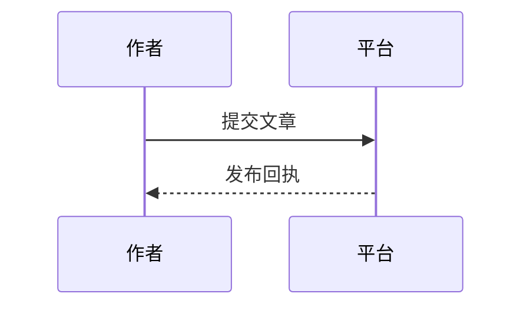

# 一级标题

中文与 English 混排，**粗体**、*斜体*、~~删除线~~、`inline_code()`。

## 二级标题

### 三级标题

#### 四级标题

##### 五级标题

###### 六级标题

普通换行第一行
普通换行第二行

硬换行第一行  
硬换行第二行

3. 第三项
4. 第四项
   - 嵌套列表

- [x] 已完成
- [ ] 待处理

> 引用内容，包含 **重点**。

| 左对齐 | 居中 | 右对齐 |
| :--- | :---: | ---: |
| 中文 | `code` | 123 |

```typescript
const result = await saveDraft(content);
  console.log(result);
```

行内公式 $E=mc^2$。

$$
\frac{a}{b}+\sqrt{x}
$$




脚注示例[^note]。

[^note]: 脚注正文。

<details open>
<summary>折叠内容</summary>
<p>HTML 正文<br>换行</p>
</details>


[跳转二级标题](#二级标题)
